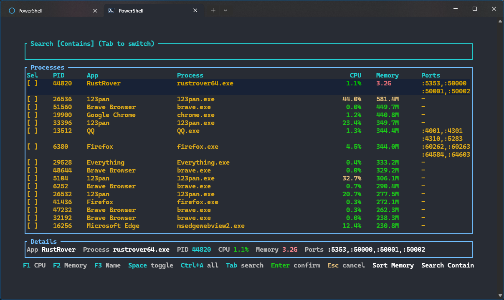

# fuckport

[](https://crates.io/crates/fuckport)
[](https://docs.rs/fuckport)
[](LICENSE)

`fuckport` is a small command-line tool for stopping processes by PID, process name, or listening port.

## Features

- Kill by PID: `fuckport 1234`
- Kill by process name: `fuckport chrome`
- Kill by port: `fuckport :3000`
- Kill processes using files or directories under a directory tree: `fuckport --directory ./project`
- Kill multiple targets in one run
- Interactive picker when no target is provided
- Graceful shutdown where supported, with automatic fallback to force kill

## Install

```bash
cargo install fuckport
```

For local development:

```bash
cargo install --path .
```

Or build locally:

```bash
cargo build --release
```

## Usage

```bash
fuckport [OPTIONS] [TARGET]...
```

---



Targets:

- `1234` treats the value as a PID
- `:8080` treats the value as a port
- Any other value is matched against process name and command line

Options:

- `-f, --force`: force kill immediately
- `-c, --case-sensitive`: enable case-sensitive name matching
- `-d, --directory <DIR>`: kill processes holding files or directories under `DIR`
- `-F, --file <FILE>`: kill processes holding `FILE` open
- `-i, --interactive`: open the interactive selector
- `-s, --silent`: suppress success output
- `-v, --verbose`: show more detail in interactive mode
- `--force-after-timeout <N>`: wait time before escalating to force kill
- `--wait-for-exit <N>`: maximum wait before reporting failure

## Examples

Kill a process by PID:

```bash
fuckport 1337
```

Kill a process by name:

```bash
fuckport safari
```

Kill whatever is listening on a port:

```bash
fuckport :8080
```

Kill processes holding files or directories under a project tree:

```bash
fuckport --directory ./project
```

Kill multiple targets in one command:

```bash
fuckport 1337 safari :8080 --directory ./project
```

Run without arguments to open the interactive interface:

```bash
fuckport
```

To kill a port, prefix it with a colon, for example `:8080`.

The interactive interface can be closed with `Esc` without killing anything.

Process name matching is case-insensitive by default. Queries containing uppercase letters use smart-case matching.

### Platform behavior

- **macOS / Linux:** request shutdown with `SIGTERM`, then send `SIGKILL` after `--force-after-timeout`. Failed termination attempts can retry through `sudo`. File and directory inspection requires `lsof`.
- **Windows:** post `WM_CLOSE` to the target process's desktop windows and wait for `--force-after-timeout`. If the process does not exit, or has no windows that accept the request, terminate it with `TerminateProcess`. Console applications and services have no generic graceful shutdown mechanism in this tool. `--force` skips window close requests.
- Windows termination failures preserve the system error. For access denied, retry from a terminal opened with **Run as administrator**. The tool does not automatically trigger UAC; protected processes may remain inaccessible even with administrator permissions.
- Windows file inspection uses Restart Manager. Directory inspection scans accessible disk handles and process working directories. Inaccessible processes or unresolved handles produce a warning that the result may be incomplete. Socket enumeration failures are shown as warnings, including in the interactive selector.
- The process list and port mappings in the interactive selector are a startup snapshot.

Library-style examples:

```bash
cargo run --example parse_targets
cargo run --example list_processes
```

## Test

```bash
cargo test
```

## Release

```bash
cargo package
cargo publish
```
